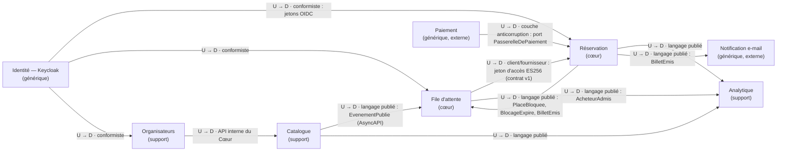

# Carte de contexte — version provisoire

> Tirée de l'ADR 002. **À confirmer à l'Event Storming** (dette D-012) : les frontières et les
> relations peuvent bouger après l'atelier.

## Sous-domaines

| Contexte délimité | Sous-domaine | Pourquoi                                                                                   | Unité déployable |
| ----------------- | ------------ | ------------------------------------------------------------------------------------------ | ---------------- |
| **Réservation**   | **Cœur**     | Zéro survente : c'est la promesse de TicketRush                                            | Cœur             |
| **File d'attente** | **Cœur**    | Ce qui rend la vente équitable et tenable au pic : ce qui différencie TicketRush           | File d'attente   |
| Catalogue         | Support      | Nécessaire et spécifique (salles, plans), mais pas différenciant                           | Cœur (+ Meilisearch) |
| Organisateurs     | Support      | Back-office, isolation, audit : spécifique mais classique                                  | Cœur             |
| Analytique        | Support      | Suivi en direct : utile, sans effet sur la vente                                           | Analytique       |
| Paiement          | Générique    | Problème résolu partout : on l'achète (ici simulé)                                         | Faux paiement (externe) |
| Identité          | Générique    | Authentification standard : Keycloak                                                       | Keycloak         |
| Notification      | Générique    | Envoi d'e-mails : service externe, non prioritaire                                         | Externe          |

## Relations

`U` = amont (upstream, impose ou publie son modèle), `D` = aval (downstream, consomme).

| Relation                         | Motif DDD                              | Ce que cela veut dire concrètement                                                              |
| -------------------------------- | -------------------------------------- | ----------------------------------------------------------------------------------------------- |
| Organisateurs → Catalogue        | Même unité, API interne                | Le Catalogue lit les événements et tarifs par l'`api/` du module Organisateurs (ADR 002)        |
| Catalogue → File d'attente       | Langage publié                         | La File apprend l'ouverture d'une vente par `EvenementPublie` (remplace l'appel provisoire, D-014) |
| File d'attente → Réservation     | Client / fournisseur + langage publié  | La Réservation accepte le jeton signé par la File ; son format est négocié à deux (contrat v1)  |
| Réservation → File d'attente     | Langage publié                         | La File déduit le stock restant des événements de vente pour arrêter les admissions (ADR 008)   |
| Cœur, File → Analytique          | Langage publié ; l'Analytique est conformiste | L'Analytique consomme les schémas AsyncAPI tels quels                                     |
| Paiement → Réservation           | **Couche anticorruption**              | Le modèle du prestataire ne traverse jamais l'adaptateur : le domaine ne connaît que `PasserelleDePaiement` (hexagonal) |
| Identité → tous                  | Conformiste                            | On adopte les jetons Keycloak tels quels (rôles, identifiant d'organisation), sans traduction   |
| Réservation → Notification       | Langage publié                         | L'envoi d'e-mail s'abonne à `BilletEmis`, sans modifier la Réservation (M-1)                    |
